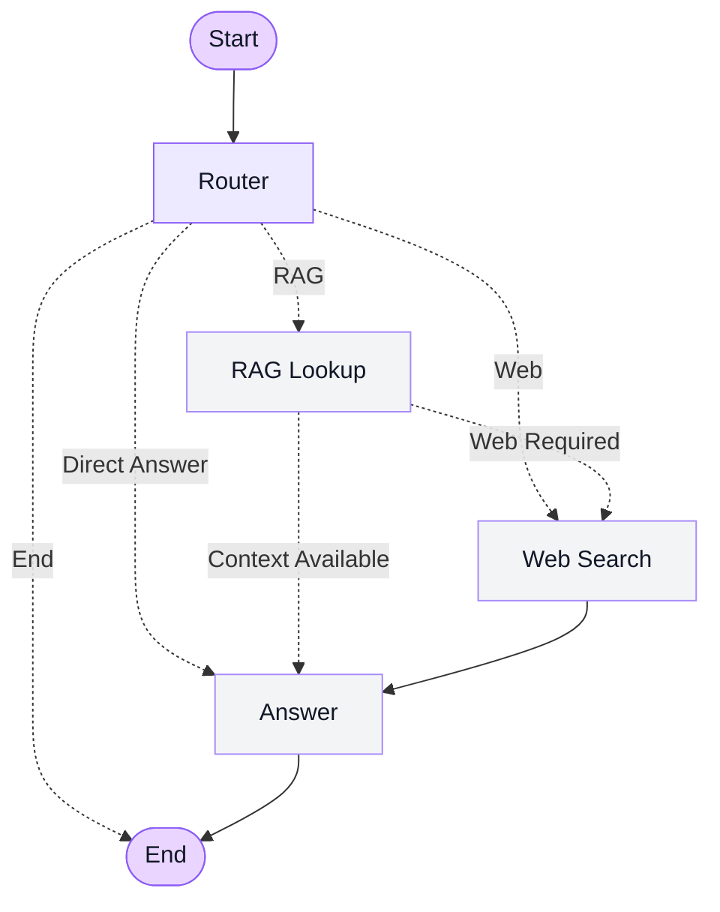

## 🔄 Agent Workflow

The Hybrid AI Agent follows a conditional workflow to answer questions by combining Retrieval-Augmented Generation (RAG) with real-time web search. Instead of using a fixed sequence for every query, the router directs each question to the appropriate processing path.

### Workflow Architecture

### Workflow Steps

1. **Start:** The system receives a user query and initializes the workflow.
2. **Router:** Analyzes the query and selects the appropriate path based on the information required.
3. **RAG Lookup:** Retrieves relevant context from the internal knowledge base to answer document-related questions.
4. **Web Search:** Searches external sources when web information is requested or additional information is needed.
5. **Answer Generation:** Produces a response using the context available from the selected retrieval paths.
6. **End:** Terminates the workflow after the response is generated, or when the router selects the end path.

### Key Design Principles

- **Intelligent routing:** Directs queries to the appropriate processing path.
- **Knowledge-grounded responses:** Uses retrieved document context to support answers.
- **Real-time information access:** Integrates web search for information beyond the internal knowledge base.
- **Conditional execution:** Avoids requiring every query to pass through both retrieval methods.
- **Modular architecture:** Separates routing, retrieval, web search, and answer generation into distinct workflow nodes.

This architecture combines internal knowledge retrieval and external information discovery to support flexible, context-aware question answering.

### Workflow Diagram

The following diagram illustrates the agent's routing logic, including RAG retrieval, web search, answer generation, and workflow termination.

